<a href="https://matejoliva.com/"><picture><source media="(prefers-color-scheme: dark)" srcset="assets/hero-dark.svg"><source media="(prefers-color-scheme: light)" srcset="assets/hero-light.svg"></picture></a>

I design governed AI, durable automation and enterprise platforms—then stay close enough to delivery to make them real.

<a href="https://matejoliva.com/portfolio-map-work-risk.html"><picture><source media="(prefers-color-scheme: dark)" srcset="assets/trail-ai-dark.svg"><source media="(prefers-color-scheme: light)" srcset="assets/trail-ai-light.svg"></picture></a>&nbsp; <a href="https://matejoliva.com/portfolio-map-work-innovation.html"><picture><source media="(prefers-color-scheme: dark)" srcset="assets/trail-automation-dark.svg"><source media="(prefers-color-scheme: light)" srcset="assets/trail-automation-light.svg"></picture></a>&nbsp; <a href="https://matejoliva.com/portfolio-map-work-agentic-platform.html"><picture><source media="(prefers-color-scheme: dark)" srcset="assets/trail-tools-dark.svg"><source media="(prefers-color-scheme: light)" srcset="assets/trail-tools-light.svg"></picture></a>&nbsp; <a href="https://matejoliva.com/portfolio-map-work-energy.html"><picture><source media="(prefers-color-scheme: dark)" srcset="assets/trail-web-dark.svg"><source media="(prefers-color-scheme: light)" srcset="assets/trail-web-light.svg"></picture></a>

### Selected work

<picture><source media="(prefers-color-scheme: dark)" srcset="assets/mark-yellow-dark.svg"><source media="(prefers-color-scheme: light)" srcset="assets/mark-yellow-light.svg"></picture>&nbsp; **[Engineering kit](https://github.com/matej-oliva/engineering-kit)**

A small, versioned foundation for how work moves from an idea to verified delivery. Public on GitHub under the MIT licence, with a guide, a contract of rules and a reference checker.

<picture><source media="(prefers-color-scheme: dark)" srcset="assets/mark-red-dark.svg"><source media="(prefers-color-scheme: light)" srcset="assets/mark-red-light.svg"></picture>&nbsp; **[AI-assisted open-source financial-risk screening](https://matejoliva.com/portfolio-map-work-risk.html)**

Screening and document analysis, with a person making the final judgement.

<a href="https://matejoliva.com/"><picture><source media="(prefers-color-scheme: dark)" srcset="assets/btn-all-work-dark.svg"><source media="(prefers-color-scheme: light)" srcset="assets/btn-all-work-light.svg"></picture></a>&nbsp; <a href="https://www.linkedin.com/in/matej-oliva/"><picture><source media="(prefers-color-scheme: dark)" srcset="assets/btn-linkedin-dark.svg"><source media="(prefers-color-scheme: light)" srcset="assets/btn-linkedin-light.svg"></picture></a>

Map: Prague. Contour lines from <a href="https://github.com/tilezen/joerd/blob/master/docs/attribution.md">open elevation data</a> · Water and trails: © <a href="https://www.openstreetmap.org/copyright">OpenStreetMap</a> contributors.
